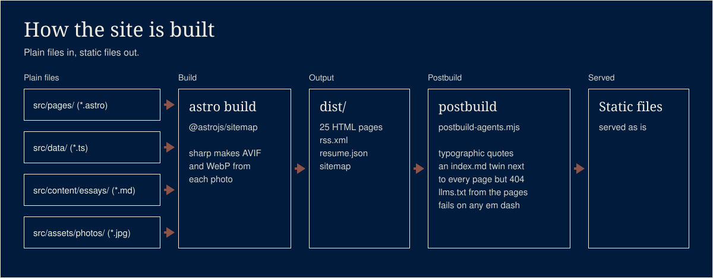

# jaysueno.com

This is the code behind [jaysueno.com](https://jaysueno.com), a personal site in plain files an AI
agent can edit: no CMS, no plugins, no admin screen. It is a snapshot of the app folder from my
private website monorepo, taken on November 8, 2026, with its shared packages copied in so it
builds on its own. The lead form writes to a database table that the public key can insert into
and never read; a trigger hands the row to a function that emails me.

## What it does


A static personal site built with [Astro](https://astro.build) 7: 25 pages, from the home page
and an about page to a resume, a numbers page, work pages and four essays.

- **Plain files.** Pages are `.astro` files, facts live in `src/data/*.ts`, essays are Markdown
  in `src/content/essays/`, and the design tokens are CSS custom properties at the top of
  `src/styles/global.css`. An agent edits the site the way it edits code.
- **Built for agents as well as people.** After the build, every page gets a Markdown twin at
  `/<page>/index.md`, made from the same HTML so the two cannot drift. The 404 page is the one
  exception: it is not indexed, so it has nothing for an agent to read. `llms.txt` is generated
  from the pages that exist. Every page carries a JSON-LD Person graph. There is an RSS feed, a
  `resume.json` in JSON Resume format, a sitemap dated from git history, and a `robots.txt` that
  welcomes search and AI crawlers.
- **Photos.** JPEGs in `src/assets/photos/` are built into AVIF and WebP at several widths.
- **A lead form behind row-level security.** The form inserts a consented inquiry into a
  Supabase table. The public key can insert and never read. A database trigger hands the new row
  to an Edge Function that sends two emails through Resend: an alert to the owner and a short
  reply to the visitor.
- **House rules in code.** The build fails if an em dash reaches anything a person or an agent
  reads, and straight quotes become typographic ones in visible text.

### This is a snapshot

This repo is a snapshot of the site's app folder, taken on 2026-11-08 (November 8, 2026). The live
site is built and deployed from a private monorepo, and that monorepo stays the source of truth.
This copy will not follow later changes, and a pull request here will not reach jaysueno.com.

What changed on the way out of the monorepo:

- **Copied in**, so it builds alone: the two head components (`src/vendor/`), the sitemap
  `lastmod` helper (`lib/sitemap-lastmod.mjs`), the TypeScript base config, and a trimmed copy of
  the one retreat data file the Vultun work page reads (`src/data/core-to-surf.json`).
- **Removed:** Google Tag Manager and its analytics events, the IndexNow key file, the script
  that prepared photos from the owner's own photo folders, nine photos no page used, and all
  image metadata except the color profile (`exiftool -all= -tagsfromfile @ -icc_profile`).
- **Replaced:** the live Supabase URL and anon key in `site.config.ts` and m0002 with
  placeholders; the webhook secret in `supabase/migrations/m0002_jaysueno_leads_notify.sql` with
  the placeholder `<set-in-supabase-vault>`; the contact address in code with the
  `PUBLIC_CONTACT_EMAIL` variable (the essays keep the address as published); the alert inbox
  with the `LEAD_NOTIFY_TO` secret; a customer's first name in one essay with "one of our
  regulars".

### About the Supabase key

`site.config.ts` ships with placeholders for the Supabase project URL and anon key
(`https://YOUR-PROJECT.supabase.co`, `YOUR-ANON-KEY`); the live site's values were taken out of
this snapshot, and the same goes for m0002. Fill in your own. An anon key is public by design: it
ships in every visitor's browser. Row-level security lets that key insert a consented lead with
status `new` and nothing else, no select, no update, no delete (see
`supabase/migrations/m0001_jaysueno_leads.sql`). So an anon key in the config is not a leaked
secret. The service key and the webhook secret never belong in the repo.

## Run it

Node 22.23.4 or newer (Astro 7 needs it) and pnpm 10 (`corepack enable` gives you the version
pinned in `package.json`).

```bash
pnpm install --frozen-lockfile
pnpm dev                                          # http://localhost:4323 (set in astro.config.mjs)
PUBLIC_CONTACT_EMAIL=you@example.com pnpm build   # static site in dist/
pnpm preview                                      # serve dist/
```

Without `PUBLIC_CONTACT_EMAIL` the pages show `hello@example.com`. The build reads git history
to date the sitemap; outside a git checkout it leaves the dates out. `pnpm sync:essays` pulls the
newsletter's public RSS feed into `src/content/essays/` (it needs the network). The lead form
sends nothing until you create your own Supabase project and put its URL and anon key in
`site.config.ts`; until then it points visitors at email. See `supabase/README.md`.

## Test it

[](https://github.com/jaysueno/jaysueno.com/actions/workflows/ci.yml)

```bash
pnpm install --frozen-lockfile
pnpm test     # node --test, about a second, no network
pnpm build    # CI runs this too
```

`test/snapshot.test.mjs` guards the promises above: no tag manager or ad pixel code, the webhook
secret is a placeholder in every migration that sends it, `site.config.ts` and m0002 carry
placeholders instead of the live project's URL and key, the form stays unconfigured while they
are placeholders, no personal mail address, no em dash in any source file, no file name with a
space, every photo a page asks for exists, and no import reaches outside this folder.
`test/sitemap-lastmod.test.mjs` runs the sitemap helper against a throwaway git repo with fixed
commit dates.

## How it works




```
 src/pages/*.astro   src/data/*.ts   src/content/essays/*.md   src/assets/photos/*.jpg
          \               |                 /                          |
           +------ astro build + @astrojs/sitemap ------------- sharp: AVIF + WebP
                          |
                        dist/   25 HTML pages, rss.xml, resume.json, sitemap
                          |
           scripts/postbuild-agents.mjs
             typographic quotes in visible text
             an index.md twin next to every page but the 404
             llms.txt from the pages that exist
             fails the build on any em dash
                          |
                    static files, served as is


 lead form --(anon key: INSERT only)--> jaysueno_leads (row-level security)
                                              |
                               trigger m0002 (pg_net, x-webhook-secret header)
                                              |
                                  Edge Function lead-notify --> Resend
                                                                 |- alert to the owner
                                                                 |- reply to the visitor
```

| Folder | What is in it |
|---|---|
| `src/pages/` | One file per page. `resume.json.ts` and `rss.xml.ts` are endpoints. |
| `src/data/` | The facts the pages read: identity, numbers, resume, work, books, music. |
| `src/content/essays/` | The essays as Markdown, pulled from the newsletter's RSS feed. |
| `src/components/`, `src/layouts/` | Nav, footer, the photo and figure components, the lead form. |
| `src/vendor/` | Head and schema components copied from the monorepo's shared UI package. |
| `lib/` | The git-derived sitemap `lastmod` helper. |
| `scripts/` | The postbuild step and the essay sync. |
| `supabase/` | The lead table, its row-level security, the trigger and the Edge Function. |
| `test/` | `node --test` suites. |

## What it will not do

- It has no CMS, no admin screen, no comments and no search. A copy change is a file edit.
- It carries no analytics in this snapshot. The live site's tag manager was removed here.
- It does not deploy. There is no deploy config; the live site deploys from the monorepo.
- The lead form sends nothing until you create your own Supabase project and fill its URL and
  anon key in `site.config.ts`. The email alerts also need the function's secrets and the webhook
  secret in Vault.
- It is not a theme. The words, photos and facts are one person's site.

## License

The code is MIT. See [LICENSE](LICENSE). The essays, page copy and photographs are copyright 2026
Jay Sueno, all rights reserved, and are not covered by the MIT license. See
[CONTENT-LICENSE.md](CONTENT-LICENSE.md).
