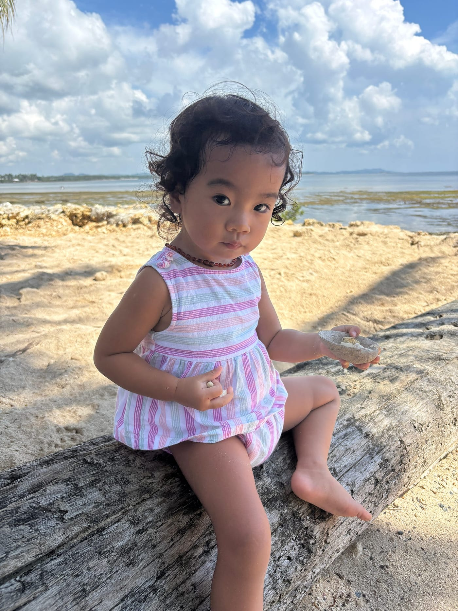
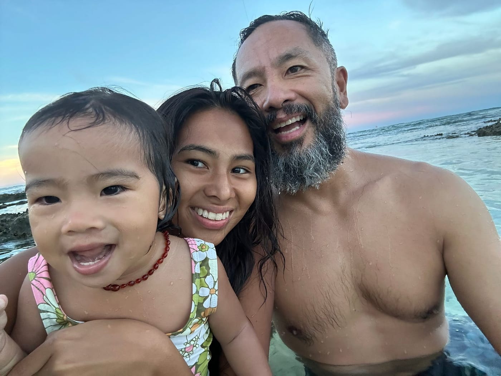

Dear Ember,

You’re almost two. Not old enough to understand this letter. One day you will, and I hope it lands well in your heart.

As your father, I’m here to love you, protect you, and make sure you have the skills to face the world ahead of you.

I will do my best.

Ember picking shells and rocks at Vultun Jacking Horse Beach.

But here’s the truth. Time has sped up. What once felt like the deep future is now near, and I don’t know what kind of world you will inherit.

It was with faith, hope, and a whole lot of love that your Mama and I brought you into this world.

So I’ll leave you with a prayer.

* * *

May you always be kind. First to yourself, and then to others.

When the day darkens, the cold rain wets you to the bone, and the potholes are deep as canyons, may you stay strong. Know that you have an inner resilience passed down through a lineage of explorers, farmers, and seafarers.

Just take the next step.

May you be courageous. Look fear in the eye. Tell it you will hold its hand as you walk together into the great unknown.

May you always remember that you are loved.

Deeply.

May you discover your own relationship with the Great Source, with God. He lives within us, moves through us, and surrounds us. Close your eyes. Be silent. Speak with Him.

You possess an inner light so bright that no one can dim it. An eternal flame. May you never forget to connect with whatever sparks your fire.

We named you Ember for a reason.

Trust that the universe has your back.

May you always be joyful. May you take time to smell the flowers. Laugh with life. Dance, sing, surf.

Just for the sake of it.

May you make time for silence. No devices. No distractions. Just yourself and nature. It is healing. It will show you the way.

May you be grateful, even in times when you lose or feel lost. There is always something to learn.

This too will pass.

And when the harvest is abundant, when the world feels like it rests in your palm, when the warmth of the sun lies on your face as you float in a calm ocean, know that this too will pass.

Be grateful then, too.

You are the most curious person I know. You learn so fast. It is one of your powers, and may you always nurture it.

May you know beauty. It is the fabric of the universe. Be a vessel of creation.

One day, if you choose, I hope you find a man who loves you well. A man who is healthy. Steadfast. Strong.

And may you know that your Mama and I are with you.

Always.

Tide pool at Tuason Beach.

<3

Papa

_PS - I’m writing these words now because memory is imperfect, time moves fast, and one day I want you to know what your father hoped for you._
