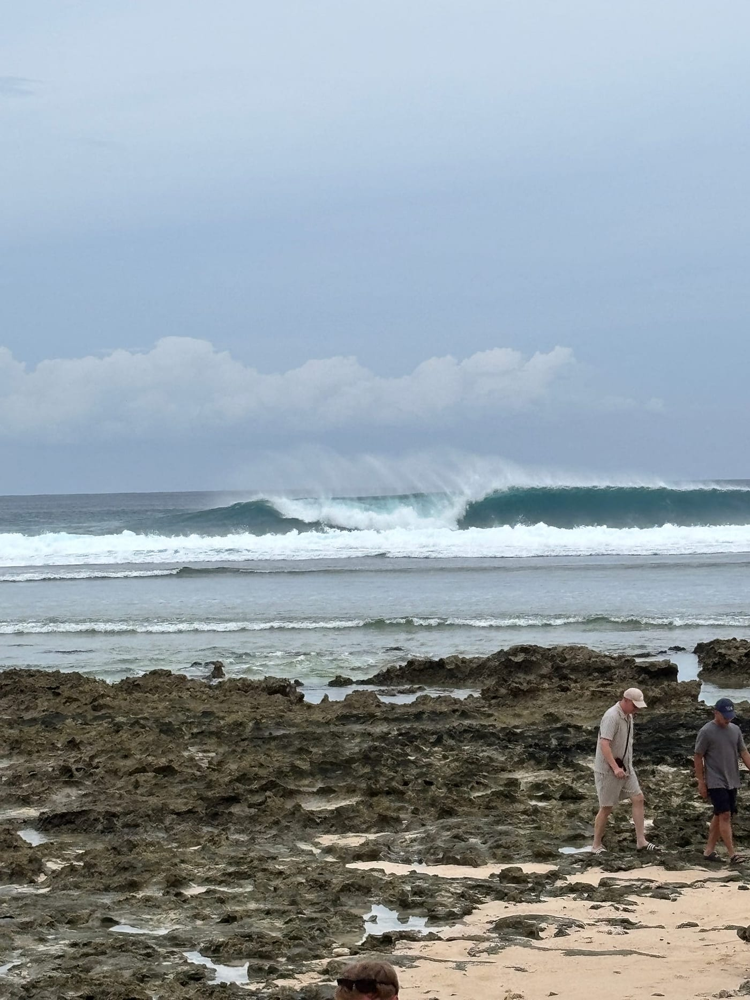
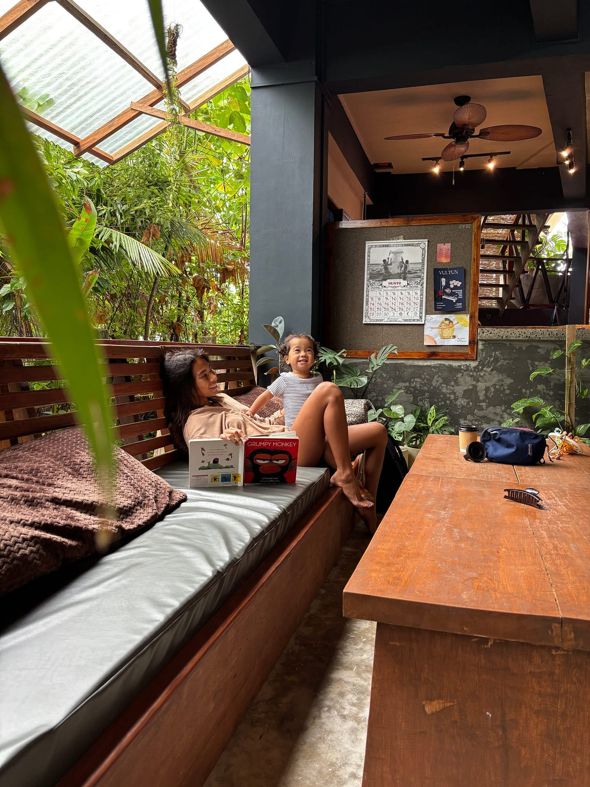
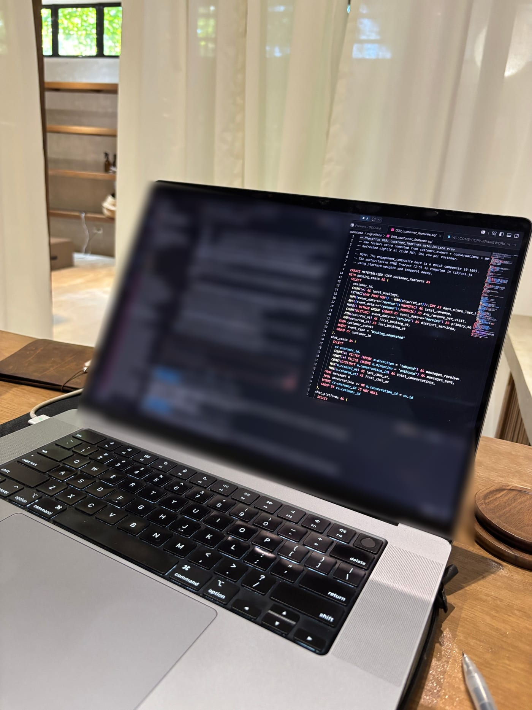
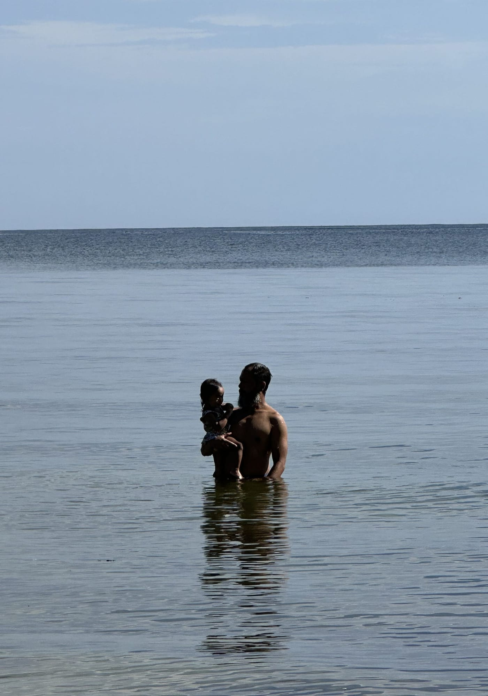
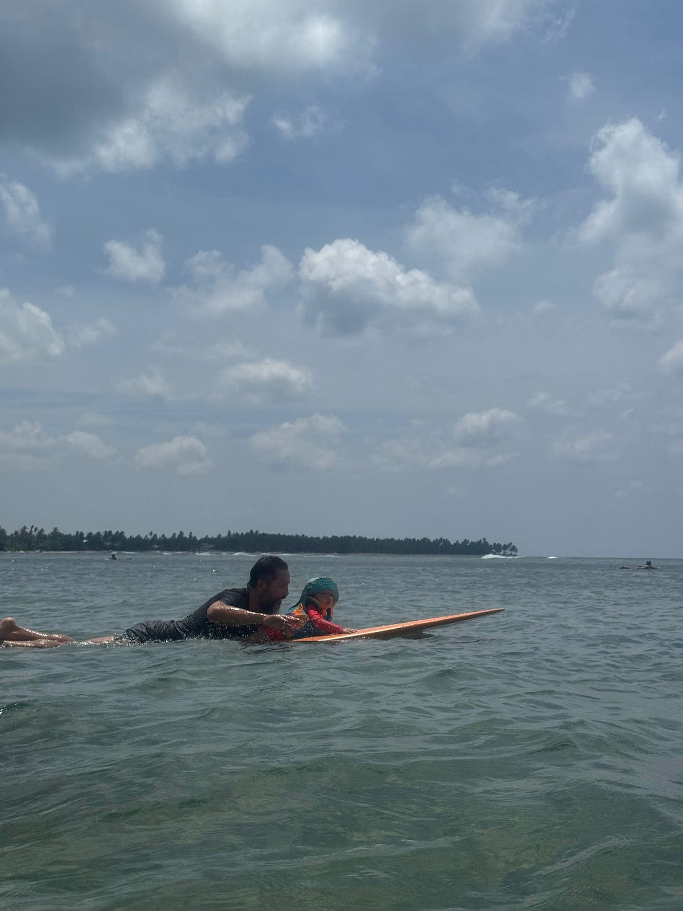
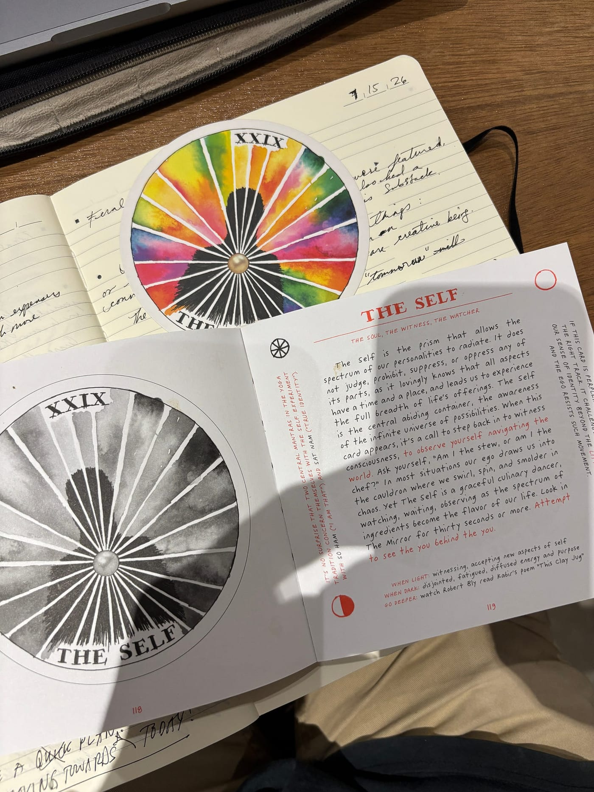

Last week, I woke up in the middle of the night to a throbbing pain in my toe. With each heartbeat, the discomfort pulsed through my right foot.

Oh no…

My gout is back.

## Fiesta, lechon, and an old visitor

In the Philippines, there’s a tradition called Fiesta or _Pista_. Each barangay or town has its annual throwdown. Families open their homes. Food is everywhere. Karaoke is inevitable. It’s also a chance to show people you’ve made it, or at least that you can throw a hell of a party.

Our little barangay of Santa Fe, on the island of Siargao, just had ours. And you guessed it, lechon was on the menu at everyone’s party.

I don’t usually eat pork. So naturally, I ate as much of it as I could that weekend.

Don’t get gout when a swell comes into town. Always be ready and eat healthy. Tuason beach, Siargao 7/8/26

This brings me back to the gout flare. I used to be a raging alcoholic who lived in pure excess. Gout would flare regularly. It’s one of the reasons I decided to quit drinking.

For the last seven years, I have not had a single gout flare. And thank you, yes, it’s been a while since I gave up the sauce, but that journey will be another article.

## Paradise with an undercurrent

Siargao is an island growing, almost too fast. It’s a sign of the times.

Money is moving around the island in ways that aren’t always obvious at first. The Lola over there still wearing a mumu, who has never been on a plane? Her family might be sitting on land worth more than most people will make in a lifetime. The next-door neighbor running a sari-sari store and housing eight family members from three generations? They might suddenly sell some beachfront property and start a couple of businesses.

Brand-new trucks are filled with people in the bed, joyriding around the circumferential roads of the island. Siargao is partying. Food is flowing.

And the Joneses are starting to arrive.

Which brings me to an inner conflict. There’s both a beauty and an ugly undercurrent running through the Isla.

The introduction of money, development, and shiny things has brought some of the less desirable parts of modernization. Opportunistic people looking to make money off of you.

Want to buy land? Sure, I’ll sell you some that I don’t own.

Want to build your dream business? Let me quote you a number, charge you double by the end, and then not finish the work.

The hustle is real.

I’ve learned some expensive lessons about building here. One of them is to watch out for contractors who hide their costs and won’t itemize their cost structure. Separate the labor, materials, and markup.

Always.

I’ll write much more about building and doing business in Siargao. There is a lot to say. And I’m not above any of it. I feel the pull too, the desire to get ahead, find the next opportunity, build something bigger, and prove that I arrived here at the right time.

_Vultun Wellness Café at Feral Pilates in Malinao. Allegra and our daughter enjoy a moment._

Then there are the infrastructure woes. Electricity is a luxury. Roads are what we get after certain politicians have lined their pockets. A real airport and affordable ticket prices?

Good luck!

Despite all that, there are moments when Allegra and I look at each other with our psychic connection and are like, “Holy wow. We actually live here.”

Looking out into the cotton-candy sunsets. A glassy ocean with perfect rolling waves. A thriving community of people who care. Young parents who have agreed to give their kids the gift of connecting to their senses and nature instead of a high-rise and Uber Eats, or Grab, here in the Philippines.

You mean we can get out of work, and thirty minutes later, we’re on a boat to a remote break where only Allegra and I are surfing and laughing our brains off? While our little daughter plays on the beach with her yaya?

I wouldn’t trade this for the world.

## Feast and famine

And then the slow season comes. Business is hard. Money is scarce. And we wonder if we made the intelligent choice.

As fast as I can, I’m learning AI vibe-coding with Claude Code. I’m setting up agents to automate everything from marketing to our websites. I’ve replaced around $500 a month in subscriptions with custom-made apps built for a business like mine, one focused on wellness, community, and hospitality.

_Coding and developing AI systems at our studio, [Feral Pilates Siargao](http://vultun.com/feralpilates/)._

I’m still learning. Sometimes I feel like a genius. Sometimes I spend six hours trying to fix something that turns out to be one missing comma.

Such is the revolution.

But I believe these tools can help small businesses understand their customers, improve their operations, and, more importantly, free up some of their time. I’ll share more about what I’m building, what has worked, and the many things that have broken along the way.

## Why I stopped writing

So why has it taken so long since I last wrote?

Because life hit me over the head with all of the things. But now I’m back.

Promises are made to be broken, but I’ll make you another.

I promise to share my journey with you, about one article a week, on topics like:

-   **Personal transformation:** mind, body, and spirit.
    
-   **Building businesses in Siargao:** wellness, real estate, operations, and networking.
    
-   **Fatherhood in my forties:** family, relationships, and trying to be present.
    
-   **Insights and experiments:** what I’m learning, what I’m trying, and how I’m doing it.
    

Not because I have everything figured out.

Clearly, I do not.

But writing helps me think clearly. And sharing it might help someone else think clearly too.

## A few reflections lately

**Enough is easy to forget.**

Siargao is a place where real estate keeps going up. Everyone wants to be first. Everyone wants to find the next opportunity. We’re all racing toward something.

But when is enough?

Recently, we’ve been taking walks through the jungle toward the beach. I watch my baby enjoy a freshwater bath after swimming in the ocean.

And it’s enough.

Her smile is genuine, like a flower blooming. The joy and beauty are just in being her truth.

_Santa Fe Beach with my daughter._

**Keep a healthy margin for error.**

Also known as liquid savings.

Siargao is a seasonal island. Feast or famine. I invested in our businesses and online. I forgot to save enough for the rainy days.

Or in Siargao, the summers are slow.

You never know what happens in life, so be prepared.

**Frugality and minimalism are not punishments.**

They can be a mindset and a way of life that strips away distractions. What we are left with is an inner reference point. We remember that we are resilient and capable of joy.

Cooking. Reading a book. Smelling the kalachuchi flowers. Swimming at sunset with my family.

**The AI revolution is here, and it is speeding up fast.**

What the world looks like in three years is anybody’s guess. Prepare for the coming wave. But don’t give up your agency to the robots.

How do I prepare my daughter for an unknown world?

I’m going to do my best.

## Always Be Ready

I used to have this motto: **Always Be Ready. ABR.**

I once decided to run a marathon with two days’ notice. I saw an advertisement in my old town of Encinitas, and I knew I was fit and ready. I could say yes because I had already done the work.

In Siargao, or anywhere, if you stay long enough, opportunities will arise. You just have to be ready to step up to them.

Properties or businesses will become available. Do you have the cash? Are your operations ready?

An epic surf swell will arrive in the middle of the flat season. Are you ready to paddle into giants and get held under?

_Gout flare? No problem. I went knee-surfing with my daughter at Libertad Beach. Had a blast._

Which brings me back to my gout flare. It’s been a week and a half since then.

I let myself slip recently. Eating unhealthy foods. Not working out as much as I should. Giving in to self-loathing and anxiety. Forgetting my truth. Chasing the Joneses and the idea of more, more, more.

It’s okay to get lost in the jungle. But the key is to learn the lesson. That is the mark of an intelligent human.

We must course correct.

It will happen many times in life.

For me, gout reminded me of a life I chose to leave for one I chose to move toward. It’s the daily habits that define my truth.

Can you really call yourself an athlete if you don’t work out and eat healthy more days than not? Can you call yourself a meditator if you haven’t sat in silence in months? Can you call yourself a writer if you don’t write?

So I’ve started sitting and walking in silence. I’m writing because it helps me think clearly **and** share with my audience. I’ve gotten back to reading, even if it’s only five minutes at a time.

Because sometimes, you just have to make it so easy for yourself that you can’t help but do it.

That’s how you get out of a rut.

Or, in my case, gout.

## The Self

Is there a new beginning wanting to see the light of day in your life? Take a moment to reflect on what you can be grateful for today.

How can you strip things down and see them clearly?

What steps can you take at this moment, not “tomorrow”, so that you can move toward that which you desire?

Can you sit in silence? Put the phone and distractions down? Turn off the monkey mind?

See yourself.

I’ll leave you with a card I pulled today: **The Self**, from Kim Krans’s _Archetypes_ deck. At the center of the card is a question:

> “Am I the stew, or am I the chef?”

Am I swirling inside the chaos, reacting to every ingredient being thrown into the pot? Or can I step back, observe what is happening, and choose what I’m creating with it?

For me, that is the real beginning. Not becoming somebody else. Remembering the person behind the person. The one beneath the anxiety, ambition, comparison, and noise.

_The Self card from Kim Krans’s Archetypes oracle deck._

Thanks for reading my article.

If this article brought something up for you, reply directly or send me an email. I would genuinely like to hear from you.

And if you’re thinking about starting or improving a business in Siargao, building better systems with AI, or understanding what it really takes to operate on this island, you can learn more about [working with me here](https://jaysueno.com/).

Planning to visit Siargao? Come see what Allegra and I are building at [Vultun Wellness](https://vultun.com/) and [Feral Pilates](https://vultun.com/feralpilates/).

You can also reach me directly at **[jay@vultun.com](mailto:jay@vultun.com)**.

’Til next time,

**Jay Sueno**
