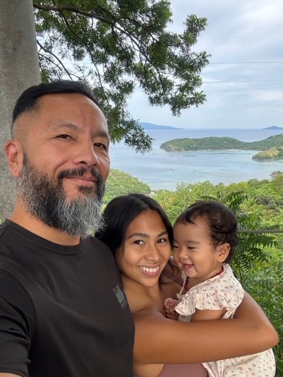
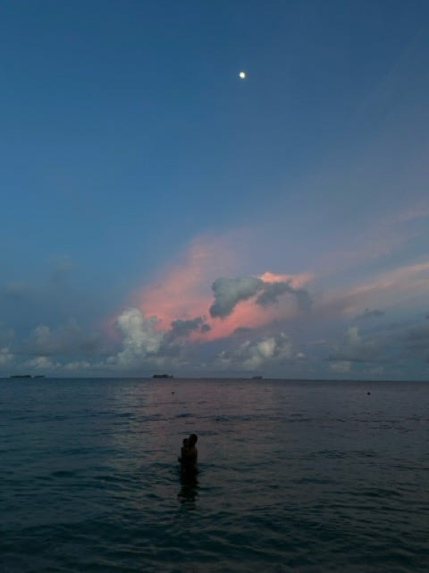

## Beginnings Are Hard

Have you ever reinvented yourself? Overcome and accomplish one of your goals? Maybe life seems great, and then boom, you realize “this level” is harder than the last?

Same.

I’ve gone from down and out to living the dream life in Siargao: soulmate, baby, and two businesses (Vultun and Feral). Life goals accomplished!

**Plot twist:** I’m less healthy than a year or two ago.

New parent. Overwhelming responsibilities. Tons of stress. Coffee to keep me going. Not enough working out. Anxiety about this and that.

I hate to admit that out loud because why would anyone trust a wellness guy who’s slipping himself?

### The Promise (What you’ll get here)

One email a week. Real life + real metrics + what I’m testing to get back to health while building businesses and raising a kid.

This is meant to be an experiment. _I’ll be sharing personal photos, videos, and stories about my journey to health and wellness, all while running a biz, raising a family, and living on an island._

### Who Is This For?

People looking for inspiration to transform their lives. A dash of biohacking nerd, a sprinkle of sarcasm, and a whole lot of vulnerability.

If you want a polished guru vibe, you’re in the wrong place. If you want the real story, including the wipeouts and getting back up, come hang.

### Why This, Why Now?

I’ve gone from broke, depressed, and sick to healthy, thriving, and a dream life in Siargao. Like in a video game, once you beat the level’s final boss, you advance to a harder stage. You begin again. This time with more skills but also with bigger challenges.

I’m now a new parent of a beautiful baby, our daughter. I’m also a parent to two businesses, [Vultun](https://vultun.com) and [Feral](https://www.instagram.com/feral.studio_). Moreover, I’ve found my soulmate and love, [Allegra](https://www.instagram.com/shesferal_).

Life goals accomplished!! Yehay!..

August 28, 2025 - Davao Oriental...

**And yet, I’ve drifted..** I’m less healthy than I was just a year or two ago. I’m now:

-   Overweight and underslept
    
-   3-5 cups of coffee a day
    
-   Working out only 1-2 times a week (if I’m lucky)
    
-   Anxiety, monkey-mind, and being easily annoyed
    

You get the point ;-)

_This blog is my personal journey of navigating this chapter of my life. Getting back to health. To my power. **The Jedi and Datu.**_

We all fall on our butts. Actually, we all get our asses kicked, and then we fall. I want to prove to myself, and you, the power of getting back up and putting one step in front of the other.

I’m excited that you’re still here, but be warned. If you don’t want to see the mundane, obnoxious, and beautiful sides of my life, unsubscribe now. I won’t take any offense!

Let’s get started.

* * *

## Baseline

January 5, 2025

I’m getting fat. All those pastries, rice meals, and late-night butter-and-bread snacks were great. Now we gotta do work.

In my head, I’m thinking, “Why would anyone trust someone not in good health with their own health?” For those of you who don’t know. I started a wellness business in Siargao.

### Metrics:

-   Weight: 178.8 lbs
    
-   Blood pressure: 130/80
    
-   Heart rate range: 43-115
    
-   VO2 max: 36.1 (below average)
    
-   Active energy: 527 calories
    
-   Steps: 10,296
    
-   Workouts: Walking 38min, Spetznatz 8min, Stretching 2min
    

* * *

## Today

January 7, 2026

Each day is a new beginning. Despite just getting back to the island and having a ton of work to do, I had the opportunity to take my wife’s mat pilates class at Buddha.

She invited. I said yes. It was brutal but great!

Today’s food was legit. For lunch, Allegra made a couscous salad with comote tops and hard-boiled eggs.

We went swimming with our daughter for sunset. A local fisherman moored his boat as we were wading in the ocean. I knew he had fish. For dinner, we bought and cooked flying fish, fresh from the ocean. Paired it with sauteed cabbage and shitake mushrooms.

### Metrics

-   Weight: 176.8
    
    lbs
    
-   Blood pressure:
    
-   Heart rate range: 34-121 bpm
    
-   VO2 max:
    
-   Active energy: 536 calories
    
-   Steps: 4,650
    
-   Workouts: Mat Pilates 60min, Ocean swim 5min
    

## Observations

The island is starting to get busier. More tourists and new construction. I feel a sense of urgency, but I also don’t want to take on new projects. I’m in the space of finishing and seeing it grow.

Our business is growing, and we need to align our team towards the same vision. Allegra and I have been talking to each of our team members 1:1 to listen to their goals and dreams and share ours. So far so good.

Vulnerability is never easy. Sharing your true feelings, especially when rooted in insecurity and fear, is hard.

The outcome? Everyone we’ve spoken to so far understands where we are coming from and is aligned with us.

Sometimes the best path is directly to the source. Want more honesty and loyalty? Be vulnerable with the other and share your “why.”

* * *

My daughter and I under the moonrise in Siargao...
