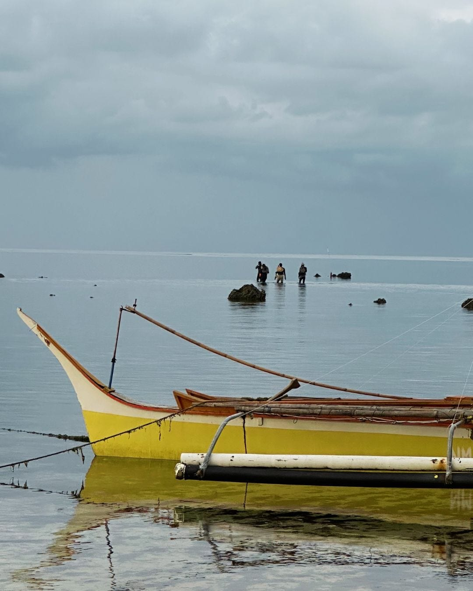
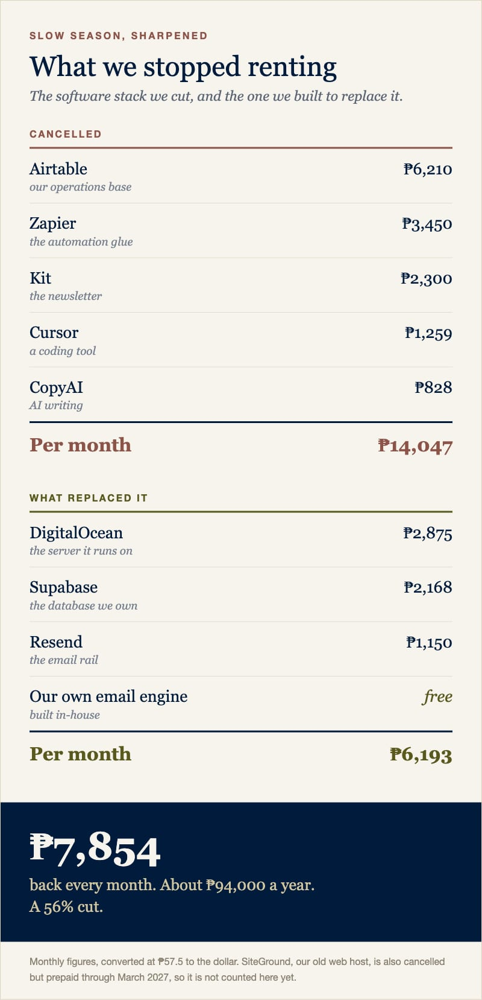
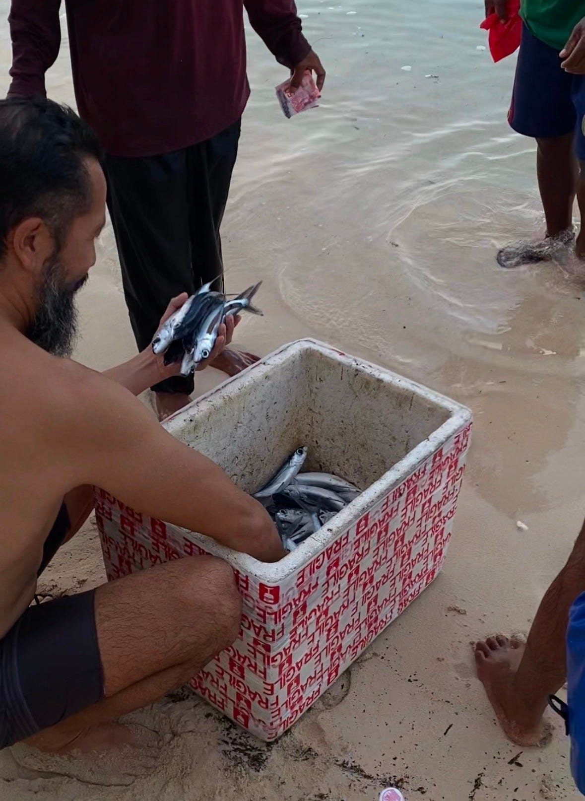
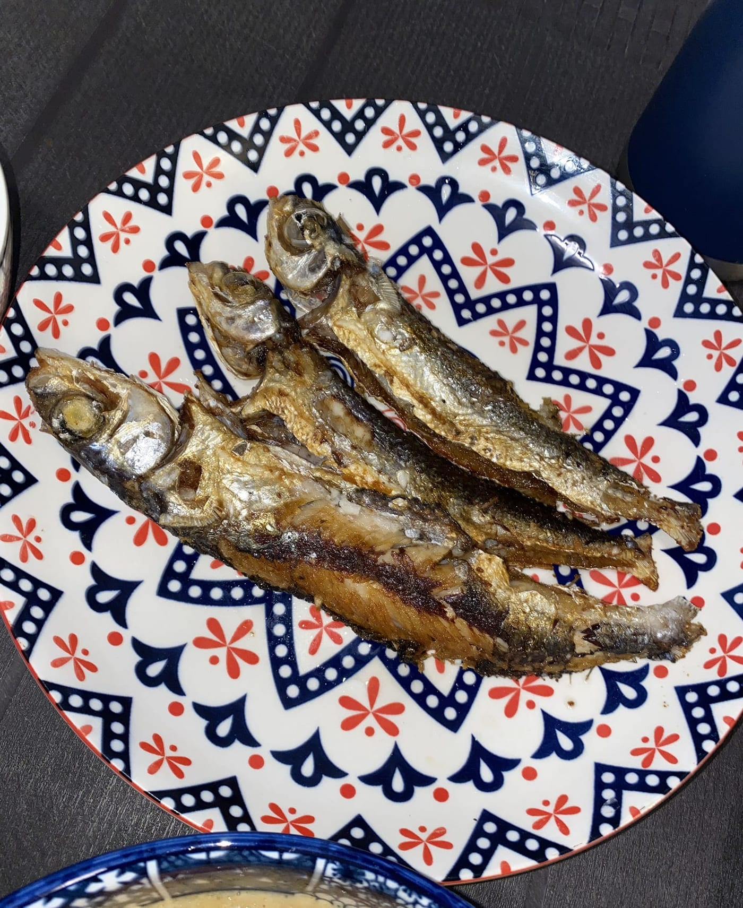

## Four O’Clock

Lately it’s been our tradition to walk from our home to the beach with our one-year-old. Sunsets are magical on the Santa Fe beaches. My daughter loves to explore the tide pools and swim with the fish.

At around 4 p.m., you can see fishing boats, called bangka, arrive from a distance to moor on the beach. Bright yellow, orange, white. Thin hulls, low to the surface. Bamboo outriggers to steady their journey into the abyss. It amazes me every time; these boats survive the open ocean.

Our daughter smiles while we float in the rich turquoise water. “Look, boat!”

They unload their catch of flying fish, mahi-mahi, and others I can’t name. Their nets dirty, but full.

Later, they will clean their nets. Repairs made to the holes. Sometimes they will extend the lengths and depths of their nets. To catch more fish, of course.

Men in black.

_Four o’clock, Santa Fe. The boat is in. Out past it, the hunters are already walking._

Men in neoprene, black rash guards and leggings. It’s an odd sight.

They carry round wooden fins and a speargun. All handmade.

They also hold a flashlight. These are the hunters of Siargao. The nighttime spearfishermen. They wear black to camouflage in the dark. They stun their prey with the light. Sharp spears. Efficient and ruthless.

The spearfisherman only takes aim at what he will kill. One clean shot, one amberjack. Talakitok, they call it here.

Two ways to bring dinner home from the same water.

* * *

## The Tide Goes Out

The slow season is here on the island. Tourists from Europe and North America are spending time in the Northern Hemisphere during summer. Surfers are in Bali and other places where the waves are working.

Our massage beds and Pilates mats are half as occupied.

Business is rough.

Our boat got heavy during the high season. A subscription here. A team member there. Yes to a consultant.

Overhead exploded.

I’ve always said that these times are perfect for taking stock, learning from your mistakes, and making improvements. Slow season is when the fisherman mends and invests in his nets. The spearfisher sharpens his spears.

In a way, business is simple. Your income needs to be higher than your expenses.

Do that, and you make a profit. String enough of those months together and you’ve created sustainability.

The inverse of this? You’ll be looking for a job.

* * *

## The Spear and the Net

Time to act. Time to cut.

The overhead crept up because I said yes to all of it. When the season is good, everything looks like building.

Optimism without margin.

The spearfisherman sharpens the spear. Cuts away at what isn’t needed.

It’s seductive to cut: canceling subscriptions, reducing hours, finding ways to decrease spend. It’s satisfying to watch the monthly expenses come down.

Cutting feels like progress because it’s fast, and I’ve been tempted to only do the fast thing.

But the harder work is increasing the catch. Retaining our valued customers and community. People like one of our regulars, who comes from Australia on a mission to connect with his highest self. He found us online, aligned with our creation story, and has been a staple at Vultun and Feral ever since.

So we invested in The Source, our membership program. We re-ignited our email marketing, which I vibe-coded into existence. We started building partnerships. We got serious about selling again.

I need a bigger net. A better one.

* * *

## Fifteen Flying Fish

As the banka moors, I hand our daughter to Allegra. The sun comes low over the trees as we walk out of the water and follow the fisherman up the sand. He’s carrying a large styrofoam bin with his catch.

His nets did well today.

Silver flying fish. Long wings for fins. Beautiful creatures able to soar above the Siargao sea. They are also great fried and dipped in soy sauce.

We buy 15 for 500 pesos. Enough for three meals.

Fifteen flying fish, 500 pesos. Enough for three meals.

Food is served. Pan-seared, crunchy, and delicious.

Out past the moored boat, three figures are already wading in. Black against the flat gray water. Waist deep, moving slow, carrying everything they need in their hands.

The day boat is in. The night hunt is starting.

Same water. Opposite directions. Both of them feeding a family tonight.

_Cut like a hunter. Build like a fisherman._

The spear keeps you alive this month. The net feeds you next season. One without the other is either denial or a slower kind of going out of business, and I’m not sure anymore which one takes longer.

I don’t know yet if our net is big enough. The season isn’t over. The net takes longer to show its work than the spear does. Ask me when the swell returns.

But here’s the question I keep turning over, and maybe it’s useful to you too, whether you’re running a business, a household, or just a life that got heavier than you meant it to.

What would you cut?

And what would you widen?

Tell me. I read every reply.
